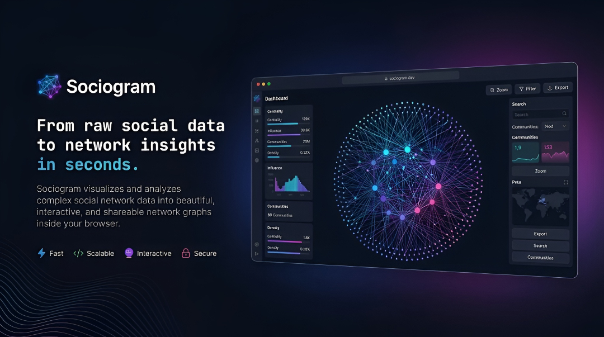
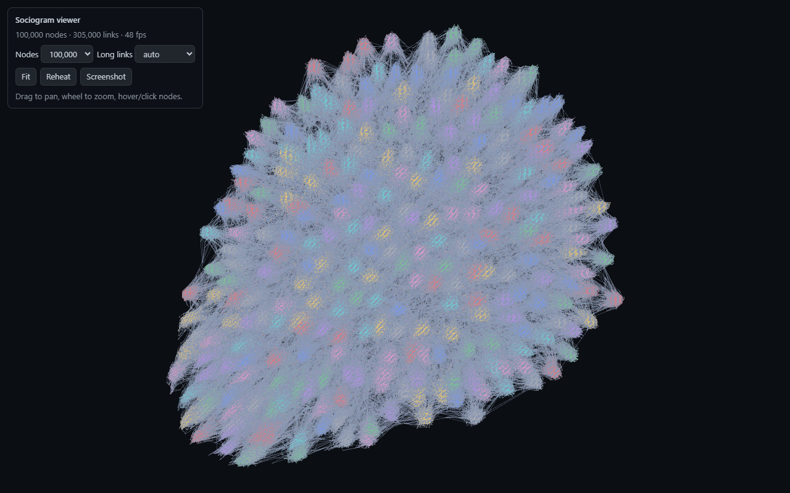

<p align="center">
  
</p>

<h3 align="center">Interactive, GPU-accelerated network graphs in your browser.</h3>

<p align="center">
  <a href="https://github.com/thazka/sociogram/actions/workflows/ci.yml"></a>
  
  
</p>

<p align="center">
  
</p>
<p align="center"><sub>Concept illustration. sociogram is the graph engine (layout and rendering). Dashboards like the one in the picture are built on top of it and are not part of this repository yet.</sub></p>

GPU-accelerated graph visualization for the browser, written in Rust and compiled to WebAssembly. Force-directed layout and rendering both run on the GPU through WebGPU (wgpu), so large networks stay interactive.

> **Status: early (0.1).** It works and is tested, but the API will change and it is not yet published to npm or crates.io. See [Status and limits](#status-and-limits).

## Screenshot

A real one: 100,000 nodes and 305,000 links grouped into communities, drawn at 48 frames per second on an integrated GPU.



## What it does

- Force-directed layout on the GPU (hierarchical-grid repulsion, springs, gravity). Tested at 100,000 nodes and 300,000 links.
- Renders nodes (anti-aliased circles) and links with per-node color and size.
- Pan, zoom to the cursor, hover and click on nodes, auto-fit camera.
- Sharp on high-DPI screens (the drawing buffer follows `devicePixelRatio`).
- `screenshot()` renders the current view offscreen and returns a PNG.
- Large graphs stay fast: long links fade out by on-screen length, and the detail adapts to the frame rate.
- Works with React, Next.js, Vue, Nuxt and Angular (see [Use it in your framework](#use-it-in-your-framework)), or with plain TypeScript.

## Quick start

Not on npm yet, so build from source (see below). Then:

```ts
import { SociogramView } from "sociogram";

const canvas = document.querySelector("canvas")!; // give it a CSS size
const view = await SociogramView.create(canvas);

view.setData({
  nodeCount: 4,
  edges: new Uint32Array([0, 1, 1, 2, 2, 3, 3, 0]), // source, target, source, target, ...
  colors: new Float32Array([
    0.96, 0.45, 0.45, 1, //  RGBA per node
    0.45, 0.80, 0.55, 1,
    0.45, 0.60, 0.97, 1,
    0.97, 0.80, 0.40, 1,
  ]),
});

view.on("nodeClick", (index) => console.log("clicked node", index));
view.on("nodeHover", (index) => console.log("hover", index)); // null when leaving a node

const png: Blob = await view.screenshot();
view.destroy(); // releases the GPU; safe to call twice
```

`create()` rejects with `WebGpuUnsupportedError` when the browser cannot run WebGPU, and with `WasmLoadError` when the engine file cannot be loaded. Invalid data makes `setData()` throw and keeps the previous graph.

`await view.whenIdle()` resolves once the GPU has finished what was submitted so far (shaders compiled, graph uploaded, first frame drawn); on the development machine that took about 0.25 s for 100,000 nodes. `mountSociogram(...).ready` is the same wait after the view is created and the initial props are applied; it resolves `undefined` instead of rejecting when creation failed or the mount was destroyed. Use them to hide a loading state. They do not speed anything up: in 6 cold-start runs here (headless Chrome, Intel integrated GPU) the first seconds showed no multi-second stall either way, so the occasional stall seen earlier in a benchmark page is still unexplained.

## Use it in your framework

One package, `sociogram`, with an entry point per framework. React, Vue and Angular are optional: installing `sociogram` does not install them. Each example below is a complete, tested app in [`examples/`](examples/README.md).

**React and Next.js** (React 18 or 19, StrictMode safe, App Router and Pages Router)

```tsx
"use client"; // Next.js: functions as props need a client component
import { Sociogram } from "sociogram/react";
import type { GraphData } from "sociogram";

export function Graph({ graph }: { graph: GraphData }) {
  return (
    <div style={{ height: 480 }}>
      <Sociogram
        data={graph}
        onNodeClick={(index) => console.log("clicked", index)}
        fallback={<p>WebGPU is not available in this browser.</p>}
      />
    </div>
  );
}
```

**Vue 3 and Nuxt** (no `<ClientOnly>` needed: the view is created in the browser only)

```vue
<script setup lang="ts">
import { shallowRef } from "vue";
import { Sociogram } from "sociogram/vue";

const graph = shallowRef({ nodeCount: 3, edges: [0, 1, 1, 2] }); // shallowRef: it can hold large typed arrays
</script>

<template>
  <div style="height: 480px">
    <Sociogram :data="graph" @node-click="(index) => console.log('clicked', index)">
      <template #fallback>WebGPU is not available in this browser.</template>
    </Sociogram>
  </div>
</template>
```

**Angular, Svelte, plain HTML: the `<sociogram-view>` Web Component**

```ts
import { defineSociogramElement } from "sociogram/element";
defineSociogramElement(); // once, in the browser
```

```html
<div style="height: 480px"><sociogram-view id="graph"></sociogram-view></div>
<script>
  const el = document.getElementById("graph");
  el.data = { nodeCount: 3, edges: [0, 1, 1, 2] };          // properties, not attributes
  el.addEventListener("nodeclick", (e) => console.log("clicked", e.detail));
</script>
```

In Angular, add `schemas: [CUSTOM_ELEMENTS_SCHEMA]` to the component and write `<sociogram-view [data]="graph" (nodeclick)="onClick($event)">`. Events are typed (`el.addEventListener("nodeclick", (e) => e.detail)` needs no cast). Angular's builder does not copy the engine's WebAssembly file by itself, so add it to the app's assets in `angular.json`:

```json
"assets": [
  { "glob": "sociogram_web_bg.wasm", "input": "node_modules/sociogram/dist/wasm", "output": "/" }
]
```

All three take `data`, `linkFade` and `options`, report `nodeClick`, `nodeHover`, `ready` and `error` (lower case on the Web Component: `nodeclick`, `nodehover`), and offer `fitView()`, `reheat()` and `screenshot()`. In React and Vue, `onError` and `@error` also receive the phase (`create`, `data`, `render` or `callback`), and the `fallback` is shown only for `create`.

**Bundlers.** Vite, Next.js (webpack and Turbopack) and Nuxt find the engine's WebAssembly file without any configuration. Angular needs the asset above. For any other setup, copy `node_modules/sociogram/dist/wasm/sociogram_web_bg.wasm` somewhere public and pass its URL as the `wasmUrl` option; a failed load throws `WasmLoadError` with that hint.

## Build from source

Requirements: Rust (stable), Node.js, and a browser with WebGPU (a current Chrome or Edge).

```bash
rustup target add wasm32-unknown-unknown
cargo install wasm-bindgen-cli --version 0.2.130 --locked   # must match the crate version

cd packages/sociogram
npm install
npm run build          # builds the wasm engine and the TypeScript package

cd ../../web
npm install
npm run serve          # then open http://127.0.0.1:8765/web/viewer.html
```

The viewer lets you pick the number of nodes (up to 100,000), switch link detail, and take screenshots.

## Tests

```bash
node scripts/verify.mjs      # fmt, clippy, tests (GPU tests required), package build, browser checks
cargo test --workspace       # just the Rust tests; GPU tests skip themselves without a real GPU
(cd packages/sociogram && npm test && npm run typecheck)   # unit, server-rendering and type tests
node web/verify-example.mjs next                           # one example app, built from the packed package, checked in Chrome
```

CI runs formatting, clippy and the tests that need no GPU. The GPU and browser tests need a real GPU, so `scripts/verify.mjs` runs them locally (see [CONTRIBUTING.md](CONTRIBUTING.md)).

On Windows the engine defaults to DX12 (the Vulkan backend crashes on some Intel drivers). Set `WGPU_BACKEND=vulkan|dx12|gl|metal` to override. Set `CHROME` to point the browser tests at a specific executable.

## Repository layout

| Path | What |
|------|------|
| `crates/sociogram-core` | Graph storage (CSR), camera, picking index, reference layout. No GPU code, no dependencies. |
| `crates/sociogram-gpu` | wgpu renderer and the GPU layout (compute shaders). |
| `crates/sociogram-web` | Scene logic and the WebAssembly bindings. |
| `packages/sociogram` | The npm package: TypeScript API, the React, Vue and Web Component entry points, and the wasm engine. |
| `examples` | One small app per framework (React, Next.js, Vue, Nuxt, Angular, plain TypeScript). |
| `web` | Demo viewer, example runner, browser tests and benchmarks (not published). |
| `scripts` | `verify.mjs`: everything CI checks, plus the GPU and browser tests. |

## Status and limits

Measured on one machine (integrated Intel UHD GPU, Windows 11, Chrome); expect different numbers elsewhere.

- 100,000 nodes and 305,000 links: about 46 frames per second once the layout has settled, and the layout converges into clear clusters on a community-structured test graph. Rendering long links is the main cost, which is why large graphs fade them out by default. Set `setLinkFade("off")` to draw everything.
- Layout speed: about 18 ms per step at 100,000 nodes natively and about 17 ms in the browser.
- A one-time stall of several seconds was seen at startup in the benchmark harness and is not yet explained.
- Only Chrome and Edge on one GPU have been tested. Firefox, Safari, high-end GPUs and fractional display scaling (125%, 150%) are untested.
- The framework examples were checked in headless Chrome on one machine, in development and production mode. Svelte, Solid and other frameworks can use the Web Component or `mountSociogram` (the lifecycle helper the wrappers are built on) but have no example.
- Not implemented yet: dragging nodes, selection (box and lasso), labels, clusters, link arrows and curves, node shapes and images, timeline filters, 3D, and data loaders (CSV, Parquet, Arrow).

## Contributing

Contributions are welcome. Please read [CONTRIBUTING.md](CONTRIBUTING.md) first, in particular the rule about not copying code from other projects.

## License

Licensed under either of

- Apache License, Version 2.0 ([LICENSE-APACHE](LICENSE-APACHE))
- MIT license ([LICENSE-MIT](LICENSE-MIT))

at your option. Unless you explicitly state otherwise, any contribution intentionally submitted for inclusion in this project shall be dual licensed as above, without any additional terms or conditions.

sociogram is an independent implementation and is not affiliated with any other graph visualization product.
